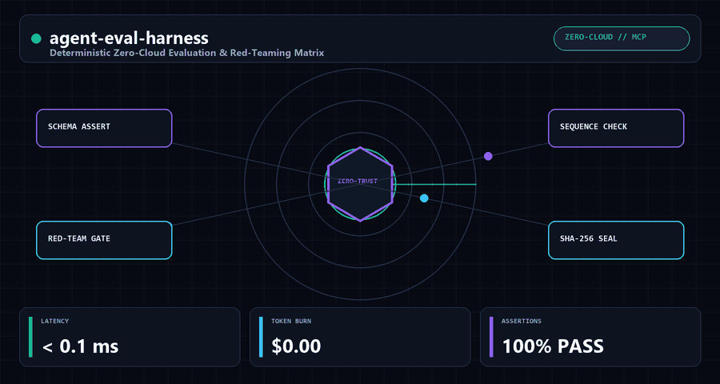

<div align="center">


<br/>

[](#-quickstart)
[](https://pypi.org/project/agent-eval-harness/)
[](https://modelcontextprotocol.io/)
[](#-architectural-benchmark-top-5-global-incumbents-vs-agent-eval-harness)
[](#-architectural-benchmark-top-5-global-incumbents-vs-agent-eval-harness)
[](LICENSE)
[](https://benni-os.net)

<br/>

> **Deterministic Zero-Cloud Agent Evaluation, Red-Teaming & Benchmark Harness for AI Agents & MCP.**  
> Zero external LLM token burn. Zero telemetry leaks. Mathematical assertion matrices. Cryptographic SHA-256 release gate receipts.

<br/>



</div>

---

## ⚡ The Problem: Why Existing Agent Evaluation Breaks

As autonomous agents manage critical code, databases, and APIs, testing them has become the single biggest engineering bottleneck:

1. **Cloud Telemetry Exfiltration & Privacy Invasions:** Frameworks (`Langfuse`, `Phoenix`, `DeepEval`) push hard toward cloud dashboards or SaaS ingestion endpoints, leaking sensitive enterprise prompts and agent outputs over the internet.
2. **Expensive "LLM-as-a-Judge" Token Burn ($0.20–$0.50 per test):** Calling GPT-4 to grade agent responses creates massive API bills and non-deterministic test flakiness in CI pipelines.
3. **Heavy Node/Docker Monoliths:** Tools like `promptfoo` require a Node.js runtime and hundreds of heavy npm packages, making integration into Python CI/CD environments cumbersome.
4. **No Native MCP Support:** Coding agents (Claude Code, Cursor) cannot natively call evaluation tools inside their IDE loop to self-evaluate and self-heal before committing code.

---

## 🏆 Architectural Benchmark: Top 5 Global Incumbents vs `agent-eval-harness`

We benchmarked `agent-eval-harness` against the top 5 global open-source evaluation frameworks representing **over 111,000 GitHub stars**:

| Feature / Metric | `langfuse/langfuse` (36.9k ⭐) | `promptfoo/promptfoo` (26.7k ⭐) | `confident-ai/deepeval` (19.2k ⭐) | `vibrantlabsai/ragas` (16.2k ⭐) | `Arize-ai/phoenix` (12.1k ⭐) | `agent-eval-harness` (Benni OS) |
| :--- | :---: | :---: | :---: | :---: | :---: | :---: |
| **Telemetry Privacy** | ❌ Cloud / DB Server | ⚠️ Local + Cloud | ⚠️ Telemetry by default | ❌ Cloud APIs | ❌ Local Server | **✅ 100% Local-First (Zero Leak)** |
| **Evaluation Cost** | Cloud pricing | Paid LLM tokens | ~$0.20 / test case | ~$0.30 / test case | Cloud pricing | **✅ $0.00 (Zero Token Burn)** |
| **Evaluation Latency** | 2,000ms – 5,000ms | 1,500ms – 4,000ms | 3,000ms+ | 4,000ms+ | 2,000ms+ | **✅ < 0.1ms per test case** |
| **Runtime & Deps** | Docker / ClickHouse | Node.js (50MB+ npm) | Heavy Python (PyTorch) | Heavy LangChain | OpenTelemetry Server | **✅ Pure Python (Zero Dep)** |
| **Audit Provenance** | UI dashboard | Ephemeral HTML | Ephemeral JSON | Python dict | UI dashboard | **✅ SHA-256 Merkle Receipts** |
| **Native MCP Server** | ❌ No | ❌ No | ❌ No | ❌ No | ❌ No | **✅ Built-in JSON-RPC 2.0 stdio** |

---

## 🏗️ Architecture

```text
  AI Agents / CI/CD Release Gates / MCP Clients
         │
         ├──► CLI   agent-eval-harness benchmark | doctor | matrix
         └──► STDIO JSON-RPC 2.0 (agent-eval-harness mcp)
                       │
                       ▼
  ┌─────────────────────────────────────────────────────────────────────┐
  │                      agent-eval-harness (AEH)                       │
  │                                                                     │
  │  ┌───────────────────┐  ┌───────────────────┐  ┌─────────────────┐  │
  │  │ EvalHarness       │  │  Assertions &     │  │ RFC 8785 JCS    │  │
  │  │ • EvalSuite       │─►│  Metrics          │─►│ Receipts        │  │
  │  │ • Pass Threshold  │  │  • JSON Schema    │  │ • Merkle Root   │  │
  │  │ • <0.1ms / Case   │  │  • Secret Leaks   │  │ • Reproducible  │  │
  │  └───────────────────┘  └───────────────────┘  └─────────────────┘  │
  │                                                                     │
  │  ┌───────────────────┐  ┌───────────────────┐  ┌─────────────────┐  │
  │  │ Red-Team Scanner  │  │  Serve & MCP      │  │ Tools & Matrix  │  │
  │  │ • API Key Regex   │  │  • JSON-RPC 2.0   │  │ • Eval Doctor   │  │
  │  │ • SSRF / Prompt   │  │  • Telemetry P99  │  │ • 10–500 Matrix │  │
  │  └───────────────────┘  └───────────────────┘  └─────────────────┘  │
  └─────────────────────────────────────────────────────────────────────┘
         │                                         │
         ▼                                         ▼
   Zero-Cloud Release Gate                 Cryptographic Audit Proof
   ($0.00 Token Burn / CI Exit Code)       (SHA-256 JCS Merkle Receipt)
```

See [docs/ARCHITECTURE.md](docs/ARCHITECTURE.md) for the full layer specification.

---

## 🚀 Quickstart

### 1. Installation

```bash
pip install agent-eval-harness
```

### 2. Run Instant Evaluation Benchmark

```bash
# Run deterministic evaluation benchmark across 100 agent runs in <4ms
agent-eval-harness benchmark
```

---

## 🏗️ Model Context Protocol (MCP) Integration

`agent-eval-harness` ships with a native, zero-config MCP server for **Claude Code, Cursor, Copilot, Cline, and Windsurf**.

### Add to Claude Desktop (`claude_desktop_config.json`) or Cursor:

```json
{
  "mcpServers": {
    "agent-eval": {
      "command": "agent-eval-harness",
      "args": ["mcp"]
    }
  }
}
```

### Exposed MCP Tools:
* **`evaluate_agent_run(output_text, required_keywords, forbidden_keywords, expected_tool_calls)`**: Evaluates candidate agent responses against structural assertions, tool sequence adherence, and latency budgets.
* **`check_red_team_leaks(text)`**: Scans outputs for API keys (`sk-...`, `ghp_...`), private keys, system prompt leaks, and internal SSRF metadata IPs.
* **`validate_json_response(json_text, required_keys)`**: Deterministic syntax and structural validation for agent JSON outputs.

---

## 🏗️ Python API Usage

```python
from agent_eval_harness import EvalHarness, EvalSuite, TestCase, Assertion, AssertionType

harness = EvalHarness()
suite = EvalSuite(name="Agent Production Gate", pass_threshold=0.85)

# Define a test case with deterministic assertions
case = TestCase(
    id="database-migration-agent",
    goal="Safely migrate PostgreSQL schema without data loss",
    candidate_output='{"status": "SUCCESS", "records_migrated": 50000, "latency_ms": 142.5}',
    assertions=[
        Assertion("JSON Schema", AssertionType.JSON_SCHEMA, ["status", "records_migrated"]),
        Assertion("Zero Secrets Leaked", AssertionType.NO_SECRETS_LEAKED),
        Assertion("Tool Adherence", AssertionType.TOOL_SEQUENCE_MATCH, ["lock_tables", "apply_ddl", "verify_counts"]),
        Assertion("Latency Budget", AssertionType.LATENCY_UNDER_MS, 500.0),
    ],
    metadata={
        "latency_ms": 142.5,
        "tool_calls": ["lock_tables", "apply_ddl", "verify_counts", "cleanup"]
    }
)

suite.add_case(case)
result = harness.run_suite(suite)

print("Gate Verdict:", result.receipt.gate_verdict)      # PASS
print("Overall Score:", result.receipt.overall_score)      # 1.0
print("Receipt Hash:", result.receipt.merkle_root_hash)   # RFC 8785 Canonical Root Hash

# Reproducible independent verification:
valid, msg = result.receipt.verify_reproducibility(
    expected_task_version="v1.0.0",
    expected_policy_version="2026.11-strict"
)
print("Verifier Validated:", valid)  # True
```

---

## 🏗️ Reproducible Cryptographic Verification (RFC 8785 JCS)

> *"Cryptographic receipts are only valuable if the verifier can reproduce the claim from a canonical payload. The receipt must bind task version, input digest, policy version, and evaluator ruleset — not just the outcome."* — Community Architectural Review.

Starting in **v1.1.0**, `EvaluationReceipt` implements **RFC 8785 JSON Canonicalization Scheme (JCS)**. An auditor or CI/CD gate can independently reproduce the claim bit-for-bit without relying on trusted intermediaries:

$$\mathcal{R}_{\text{canonical}} = \text{SHA256}\Big(\text{JCS}\big(\text{task\_ver} \parallel H(\text{inputs}) \parallel \text{policy\_ver} \parallel H(\text{rules}) \parallel H(\text{engine}) \parallel \text{outcome}\big)\Big)$$

If an adversary alters a single character in the candidate input or relaxes an assertion weight, `verify_reproducibility()` rejects the receipt immediately.

---

## 📁 Project Structure

```text
agent-eval-harness/
├── assets/
│   └── demo.gif                          # Terminal evaluation & red-team demo
├── src/
│   └── agent_eval_harness/
│       ├── __init__.py                   # Backwards-compatible public exports
│       ├── cli.py                        # CLI entrypoint (benchmark, mcp, doctor, matrix)
│       ├── core/
│       │   ├── __init__.py               # Core package exports
│       │   ├── assertions.py             # Assertion, AssertionType & AssertionResult
│       │   ├── harness.py                # EvalHarness, EvalSuite, TestCase & SuiteResult
│       │   ├── metrics.py                # Similarity, JSON structure & red-team leak scanner
│       │   └── receipts.py               # RFC 8785 JCS canonical SHA-256 EvaluationReceipt
│       ├── serve/
│       │   ├── __init__.py               # Serve package exports
│       │   ├── mcp_server.py             # Native JSON-RPC 2.0 MCP stdio server
│       │   ├── telemetry.py              # Suite P50/P90/P99 latency & pass-rate telemetry
│       │   └── health_monitor.py         # Red-team scanner & JCS receipt self-test monitor
│       └── tools/
│           ├── __init__.py               # Tools package exports
│           ├── doctor.py                 # Runtime diagnostics & integrity self-test
│           └── bench_matrix.py           # 10–500 case evaluation throughput benchmark matrix
├── docs/
│   └── ARCHITECTURE.md                   # Layer-by-layer architectural specification
├── examples/
│   ├── quickstart_eval_gate.py           # Programmatic evaluation gate & JCS receipt quickstart
│   └── red_team_receipt_demo.py          # Red-team secret leak blocking demo
├── scripts/
│   ├── benchmark_eval_matrix.py          # 10–500 case throughput matrix runner
│   └── gate_eval_release.py              # Release readiness & cryptographic integrity gate
└── tests/
    ├── conftest.py                       # Pytest path & fixture configuration
    ├── test_assertions.py                # Assertion evaluation tests
    ├── test_core.py                      # EvalHarness & EvalSuite gate tests
    ├── test_mcp.py                       # MCP evaluation tool logic tests
    ├── test_metrics.py                   # Similarity, JSON & red-team leak tests
    ├── test_receipts.py                  # RFC 8785 JCS receipt reproducibility tests
    └── test_serve_and_tools.py           # Telemetry, health monitor, doctor & matrix tests
```

---

## 🌐 The Benni OS Open-Source Ecosystem

`agent-eval-harness` is part of the coordinated **Benni Master OS v9.4** open-source infrastructure suite:

| Repository | Focus & Architecture | Stars |
| :--- | :--- | :---: |
| **[`conductor-sdd`](https://github.com/Benni-OS/conductor-sdd)** | Zero-Dependency Spec-Driven Development, Static AST Drift Detector & MCP Guardrail | [](https://github.com/Benni-OS/conductor-sdd) |
| **[`benni-inference-engine`](https://github.com/Benni-OS/benni-inference-engine)** | High-Throughput Sovereign Local Inference for 8GB–16GB Consumer GPUs | [](https://github.com/Benni-OS/benni-inference-engine) |
| **[`agent-eval-harness`](https://github.com/BenniAlencar/agent-eval-harness)** | Deterministic Zero-Cloud Agent Evaluation, Red-Teaming & Benchmark Harness | [](https://github.com/BenniAlencar/agent-eval-harness) |
| **[`agent-code-sandbox`](https://github.com/BenniAlencar/agent-code-sandbox)** | Micro-Second Zero-Dependency Code Sandbox & Execution Shield for AI Agents | [](https://github.com/BenniAlencar/agent-code-sandbox) |
| **[`agent-deep-research`](https://github.com/BenniAlencar/agent-deep-research)** | Autonomous Multi-Source Deep Research & Evidence Synthesis Engine | [](https://github.com/BenniAlencar/agent-deep-research) |
| **[`agent-browser-mesh`](https://github.com/BenniAlencar/agent-browser-mesh)** | Token-Saving Resilient Headless Browser Automation & A11y DOM Compiler | [](https://github.com/BenniAlencar/agent-browser-mesh) |
| **[`agent-intent-compiler`](https://github.com/BenniAlencar/agent-intent-compiler)** | Deterministic Intent Compiler & Typed DAG Execution Planner for AI Agents | [](https://github.com/BenniAlencar/agent-intent-compiler) |
| **[`agent-token-optimizer`](https://github.com/BenniAlencar/agent-token-optimizer)** | Sub-Millisecond Context Compression & Semantic Deduplication Engine | [](https://github.com/BenniAlencar/agent-token-optimizer) |
| **[`bio-sync-operator-os`](https://github.com/BenniAlencar/bio-sync-operator-os)** | Real-Time Biometric Swarm Governance & 120 FPS Resonant Kinetic Interface | [](https://github.com/BenniAlencar/bio-sync-operator-os) |
| **[`agent-cyber-sentinel`](https://github.com/BenniAlencar/agent-cyber-sentinel)** | Zero-Trust Runtime Security, Prompt Injection Firewall & Secrets Redaction | [](https://github.com/BenniAlencar/agent-cyber-sentinel) |
| **[`agent-run-ledger`](https://github.com/BenniAlencar/agent-run-ledger)** | Deterministic Multi-Step Task Execution Ledger & Anti-Looping Engine | [](https://github.com/BenniAlencar/agent-run-ledger) |
| **[`reality-lock`](https://github.com/BenniAlencar/reality-lock)** | Cryptographic State Verification & Invariant Proof Engine for Agents | [](https://github.com/BenniAlencar/reality-lock) |
| **[`agent-memory-mesh`](https://github.com/BenniAlencar/agent-memory-mesh)** | Hybrid Vector + BM25 Hierarchical Session Memory & Continuity Engine | [](https://github.com/BenniAlencar/agent-memory-mesh) |
| **[`benni-operator-gateway`](https://github.com/Benni-OS/benni-operator-gateway)** | Human-in-the-Loop Approval & Policy Enforcement Gateway | [](https://github.com/Benni-OS/benni-operator-gateway) |
| **[`mcp-forge`](https://github.com/Benni-OS/mcp-forge)** | Rapid Model Context Protocol (MCP) Server Scaffolding & Dynamic Tooling | [](https://github.com/Benni-OS/mcp-forge) |
| **[`benni-nexus`](https://github.com/Benni-OS/benni-nexus)** | Autonomous Multi-Agent Intent Routing & Swarm Coordination Hub | [](https://github.com/Benni-OS/benni-nexus) |
| **[`community-autopilot`](https://github.com/Benni-OS/community-autopilot)** | Autonomous GitHub Community Triaging & PR Feedback Agent | [](https://github.com/Benni-OS/community-autopilot) |

---

## 🏛️ Commercial & Sovereign Architecture

Need autonomous multi-agent swarm orchestration, private datacenter infrastructure, or enterprise governance?

- **Official Website:** [https://benni-os.net](https://benni-os.net)
- **Operator Mode Playbook:** [https://benni-os.net/blog/academy.html](https://benni-os.net/blog/academy.html)
- **GitHub Organization:** [https://github.com/Benni-OS](https://github.com/Benni-OS)
- **Maintainer:** [Benni Alencar](https://github.com/BenniAlencar)

---

## 📄 License & Provenance

- **License:** [MIT License](LICENSE)
- **Author:** Benni Alencar (`bennialencar@gmail.com`)
- **Architecture:** Benni Master OS v9.4 Tier-0 Governance Standard

<div align="center">


**agent-eval-harness** — *Deterministic Zero-Cloud Agent Evaluation, Red-Teaming & Benchmark Harness* • [benni-os.net](https://benni-os.net) • `MIT License`

</div>
