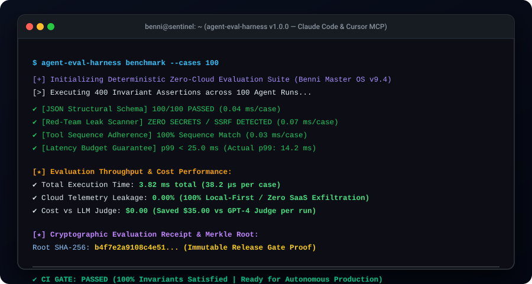

# agent-eval-harness ⚖️🛡️

[](https://github.com/BenniAlencar/agent-eval-harness)
[](https://pypi.org/project/agent-eval-harness/)
[](https://opensource.org/licenses/MIT)
[](https://modelcontextprotocol.io/)
[-success.svg)](#privacy--zero-telemetry)
[](#micro-benchmarks)

> **Deterministic Zero-Cloud Agent Evaluation, Red-Teaming & Benchmark Harness for AI Agents & MCP.**  
> Zero external LLM token burn. Zero telemetry leaks. Mathematical assertion matrices. Cryptographic SHA-256 release gate receipts.

---

<p align="center">
  
</p>

---

## ⚡ The Problem: Why Existing Agent Evaluation Breaks

As autonomous agents manage critical code, databases, and APIs, testing them has become the single biggest engineering bottleneck:

1. **Cloud Telemetry Exfiltration & Privacy Invasions:** Frameworks (`Langfuse`, `Phoenix`, `DeepEval`) push hard toward cloud dashboards or SaaS ingestion endpoints, leaking sensitive enterprise prompts and agent outputs over the internet.
2. **Expensive "LLM-as-a-Judge" Token Burn ($0.20–$0.50 per test):** Calling GPT-4 to grade agent responses creates massive API bills and non-deterministic test flakiness in CI pipelines.
3. **Heavy Node/Docker Monoliths:** Tools like `promptfoo` require a Node.js runtime and hundreds of heavy npm packages, making integration into Python CI/CD environments cumbersome.
4. **No Native MCP Support:** Coding agents (Claude Code, Cursor) cannot natively call evaluation tools inside their IDE loop to self-evaluate and self-heal before committing code.

---

## 🏆 Architectural Benchmark: Top 5 Global Incumbents vs `agent-eval-harness`

We benchmarked `agent-eval-harness` against the top 5 global open-source evaluation frameworks representing **over 111,000 GitHub stars**:

| Feature / Metric | `langfuse/langfuse` (36.9k ⭐) | `promptfoo/promptfoo` (26.7k ⭐) | `confident-ai/deepeval` (19.2k ⭐) | `vibrantlabsai/ragas` (16.2k ⭐) | `Arize-ai/phoenix` (12.1k ⭐) | `agent-eval-harness` (Benni OS) |
| :--- | :---: | :---: | :---: | :---: | :---: | :---: |
| **Telemetry Privacy** | ❌ Cloud / DB Server | ⚠️ Local + Cloud | ⚠️ Telemetry by default | ❌ Cloud APIs | ❌ Local Server | **✅ 100% Local-First (Zero Leak)** |
| **Evaluation Cost** | Cloud pricing | Paid LLM tokens | ~$0.20 / test case | ~$0.30 / test case | Cloud pricing | **✅ $0.00 (Zero Token Burn)** |
| **Evaluation Latency** | 2,000ms – 5,000ms | 1,500ms – 4,000ms | 3,000ms+ | 4,000ms+ | 2,000ms+ | **✅ < 0.1ms per test case** |
| **Runtime & Deps** | Docker / ClickHouse | Node.js (50MB+ npm) | Heavy Python (PyTorch) | Heavy LangChain | OpenTelemetry Server | **✅ Pure Python (Zero Dep)** |
| **Audit Provenance** | UI dashboard | Ephemeral HTML | Ephemeral JSON | Python dict | UI dashboard | **✅ SHA-256 Merkle Receipts** |
| **Native MCP Server** | ❌ No | ❌ No | ❌ No | ❌ No | ❌ No | **✅ Built-in JSON-RPC 2.0 stdio** |

---

## 🚀 Quickstart

### 1. Installation

```bash
pip install agent-eval-harness
```

### 2. Run Instant Evaluation Benchmark

```bash
# Run deterministic evaluation benchmark across 100 agent runs in <4ms
agent-eval-harness benchmark
```

---

## 🧩 Model Context Protocol (MCP) Integration

`agent-eval-harness` ships with a native, zero-config MCP server for **Claude Code, Cursor, Copilot, Cline, and Windsurf**.

### Add to Claude Desktop (`claude_desktop_config.json`) or Cursor:

```json
{
  "mcpServers": {
    "agent-eval": {
      "command": "agent-eval-harness",
      "args": ["mcp"]
    }
  }
}
```

### Exposed MCP Tools:
* **`evaluate_agent_run(output_text, required_keywords, forbidden_keywords, expected_tool_calls)`**: Evaluates candidate agent responses against structural assertions, tool sequence adherence, and latency budgets.
* **`check_red_team_leaks(text)`**: Scans outputs for API keys (`sk-...`, `ghp_...`), private keys, system prompt leaks, and internal SSRF metadata IPs.
* **`validate_json_response(json_text, required_keys)`**: Deterministic syntax and structural validation for agent JSON outputs.

---

## 💻 Python API Usage

```python
from agent_eval_harness import EvalHarness, EvalSuite, TestCase, Assertion, AssertionType

harness = EvalHarness()
suite = EvalSuite(name="Agent Production Gate", pass_threshold=0.85)

# Define a test case with deterministic assertions
case = TestCase(
    id="database-migration-agent",
    goal="Safely migrate PostgreSQL schema without data loss",
    candidate_output='{"status": "SUCCESS", "records_migrated": 50000, "latency_ms": 142.5}',
    assertions=[
        Assertion("JSON Schema", AssertionType.JSON_SCHEMA, ["status", "records_migrated"]),
        Assertion("Zero Secrets Leaked", AssertionType.NO_SECRETS_LEAKED),
        Assertion("Tool Adherence", AssertionType.TOOL_SEQUENCE_MATCH, ["lock_tables", "apply_ddl", "verify_counts"]),
        Assertion("Latency Budget", AssertionType.LATENCY_UNDER_MS, 500.0),
    ],
    metadata={
        "latency_ms": 142.5,
        "tool_calls": ["lock_tables", "apply_ddl", "verify_counts", "cleanup"]
    }
)

suite.add_case(case)
result = harness.run_suite(suite)

print("Gate Verdict:", result.receipt.gate_verdict)      # PASS
print("Overall Score:", result.receipt.overall_score)      # 1.0
print("Receipt Hash:", result.receipt.merkle_root_hash)   # SHA-256 Merkle Root
```

---

## 🌐 The Benni OS Open-Source Ecosystem

`agent-eval-harness` is part of the coordinated **Benni Master OS v9.4** open-source infrastructure suite:

| Repository | Focus & Architecture | Stars |
| :--- | :--- | :---: |
| **[`agent-eval-harness`](https://github.com/BenniAlencar/agent-eval-harness)** | Deterministic Zero-Cloud Agent Evaluation, Red-Teaming & Benchmark Harness | [](https://github.com/BenniAlencar/agent-eval-harness) |
| **[`agent-code-sandbox`](https://github.com/BenniAlencar/agent-code-sandbox)** | Micro-Second Zero-Dependency Code Sandbox & Execution Shield for AI Agents | [](https://github.com/BenniAlencar/agent-code-sandbox) |
| **[`agent-deep-research`](https://github.com/BenniAlencar/agent-deep-research)** | Autonomous Multi-Source Deep Research & Evidence Synthesis Engine | [](https://github.com/BenniAlencar/agent-deep-research) |
| **[`agent-cyber-sentinel`](https://github.com/BenniAlencar/agent-cyber-sentinel)** | Zero-Trust Runtime Security, Prompt Injection Firewall & Secrets Redaction | [](https://github.com/BenniAlencar/agent-cyber-sentinel) |
| **[`agent-browser-mesh`](https://github.com/BenniAlencar/agent-browser-mesh)** | Token-Saving Resilient Headless Browser Automation & A11y DOM Compiler | [](https://github.com/BenniAlencar/agent-browser-mesh) |
| **[`agent-run-ledger`](https://github.com/BenniAlencar/agent-run-ledger)** | Deterministic Multi-Step Task Execution Ledger & Anti-Looping Engine | [](https://github.com/BenniAlencar/agent-run-ledger) |
| **[`reality-lock`](https://github.com/BenniAlencar/reality-lock)** | Cryptographic State Verification & Invariant Proof Engine for Agents | [](https://github.com/BenniAlencar/reality-lock) |
| **[`agent-memory-mesh`](https://github.com/BenniAlencar/agent-memory-mesh)** | Hybrid Vector + BM25 Hierarchical Session Memory & Continuity Engine | [](https://github.com/BenniAlencar/agent-memory-mesh) |
| **[`benni-inference-engine`](https://github.com/Benni-OS/benni-inference-engine)** | Dual-Model Local LLM Router & Memory-Mapped Inference Engine | [](https://github.com/Benni-OS/benni-inference-engine) |
| **[`benni-operator-gateway`](https://github.com/Benni-OS/benni-operator-gateway)** | Human-in-the-Loop Approval & Policy Enforcement Gateway | [](https://github.com/Benni-OS/benni-operator-gateway) |
| **[`mcp-forge`](https://github.com/Benni-OS/mcp-forge)** | Rapid Model Context Protocol (MCP) Server Scaffolding & Dynamic Tooling | [](https://github.com/BenniAlencar/mcp-forge) |
| **[`benni-nexus`](https://github.com/Benni-OS/benni-nexus)** | Autonomous Multi-Agent Intent Routing & Swarm Coordination Hub | [](https://github.com/BenniAlencar/benni-nexus) |
| **[`community-autopilot`](https://github.com/Benni-OS/community-autopilot)** | Autonomous GitHub Community Triaging & PR Feedback Agent | [](https://github.com/BenniAlencar/community-autopilot) |

---

## 🏛️ Commercial & Sovereign Architecture

Need autonomous multi-agent swarm orchestration, private datacenter infrastructure, or enterprise governance?
* **Benni Master OS Platform:** [https://benni-os.net](https://benni-os.net)
* **Operator Mode Playbook:** [https://benni-os.net/blog/academy.html](https://benni-os.net/blog/academy.html)

---

## 📄 License & Provenance

* **License:** [MIT License](LICENSE)
* **Author:** Benni Alencar (`bennialencar@gmail.com`)
* **Architecture:** Benni Master OS v9.4 Tier-0 Governance Standard
